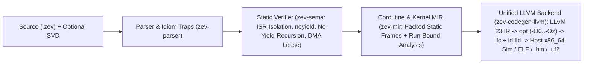

# Zev — Language & Runtime Design Specification (v0)

## 1. Core Thesis

In desktop and server software, the operating system lives outside the binary behind a syscall boundary. In bare-metal firmware, **Platform + OS + Libraries + Application** compile into one flat static binary—yet C forces artificial walls between them (RTOS port layers, manual coroutine state structs, callback tables, `#ifdef` config headers, linker scripts) because C only understands functions and structs, not tasks, interrupts, deadlines, or hardware ownership.

**Summary:**
> *Structured cooperative concurrency with static coroutine packing, compile-time ISR/DMA safety, and zero heap or per-task stacks.*

Where traditional embedded C relies on Duff's-device protothreads, manual state structs, or per-thread RTOS stacks, **Zev** (`zevc` / `.zev`) makes the cooperative kernel, static coroutine frame layout, and ISR/task isolation native to the compiler.

---

## 2. Core Semantic Pillars

### 2.1 Entry Point, Boot-Tree `spawn` & Immortal Task Lifecycle
- **Phased Sequential Boot (`fn main()`):** Execution starts sequentially in `fn main()`, preserving top-to-bottom C readability and phased boot (e.g., running PLL/clock setup and self-tests *before* control loops start).
- **Reusable Task Blueprints:** `task` definitions are **parameterized, reusable blueprints** (not auto-running global singletons). Libraries can export or encapsulate internal worker tasks without hidden background execution, and boot setup can `spawn` multiple instances (e.g., one per UART or SPI bus).
- **Boot-Tree `spawn` (Static Topology Wiring, `<= 32` Slots):** `spawn` is permitted inside `fn main()` (including conditional `if` / `switch` boot-mode branches) **and** inside any setup `fn` called during `main()`'s sequential boot phase before the scheduler starts, while statically **forbidden** inside loops, recursion, `task`s, and `isr`s (`E0027`, which also enforces the static `MAX_TASKS <= 32` scheduler limit so ready and waiter masks fit in 32-bit words). Every static boot-tree call path maps 1:1 to a compile-time-allocated `.bss` task slot and coroutine state frame (`0 B` heap, zero per-thread stacks—all tasks execute on the single hardware stack). `zevc ram` prints the full static spawn provenance path (e.g., `main -> usb.start -> usb::xfer_task @high`) plus static non-yielding run bounds (`straight-line` / `bounded-for` / `noyield-spin`).
- **Immortal Task Lifecycle (`E0026`):** Tasks model permanent subsystem actors rather than dynamic threads:
  - Both `return;` and falling off the closing `}` of a `task` body are compile-time errors (`E0026`), preventing silent dead `.bss` slots and producer/consumer channel deadlocks.
  - **`restart;`:** Explicit self-reset statement inside a `task` that unwinds active `defer`s, restores any temporary priority boost, zeroes task-local state and nested child call frames (`MirStmt::ZeroTaskLocals`, preserving `spawn` parameters), and jumps back to task entry on fault recovery.
  - **Dormant / Triggered Tasks:** Event-driven subsystems park on `inbox.recv()`, `signal.wait()`, `wait { ... }`, or `wait_queue` at `0%` CPU cost until woken.
  - **Finite / Mutually Exclusive Workflows:** Foreground sequences (e.g., power-on self-test, calibration, DFU) are ordinary yielding `fn` calls whose static coroutine frames `union`-overlap in caller SRAM when their lifetimes are disjoint.
  - **Test / Sim Exit:** Deterministic host simulations and QEMU test harnesses terminate explicitly via `sys.exit(code)`.

### 2.2 Built-In Cooperative Scheduler, Loop Semantics & Power Management
- **Bitmask Fast-Path & Bounded (`N <= 32`) Ranked Dispatch:** Priorities (`@critical`, `@high`, `@normal`, `@low`) use fixed starvation windows (`1 / 5 / 15 / 50 ms`, `Overdue -> Work -> Poll` dispatch). Uncontended `should_share()` checks, `@__syn_any_ready_task()`, and empty priority bands execute in `O(1)` via per-priority `u32` ready bitmasks (`@__syn_ready_mask`), while deadline wakeups and round-robin task selection within a populated band scan up to `@__syn_task_count` (`<= 32`) static slots linearly under an IRQ mask.
- **Demand-Driven Chunking (`should_share`):** Long background loops execute back-to-back without yielding when uncontended, yielding `MORE` only when an equal/higher-priority task wakes or a peer hits its starvation bound.
- **Uniform Cooperative Loop Auto-Checkpointing:** `loop`, `while (true)`, and `while (cond)` all auto-checkpoint cooperatively at back-edges (`SoftYielding` / `HardBlocking`) outside `noyield`, `critical`, `isr`, `defer`, or `@manual_yield`, whereas bounded `for..in` loops (`for (usize i in 0..n)` / `for (u8 b in slice)`) stay in CPU registers without auto-yielding. Wrap intentional tight register-polling `while` loops explicitly in `noyield { while (...) {} }`.
- **Init vs. Steady-State Loop Structure:** Inside a `task`, statements before `loop { ... }` represent one-time per-instance initialization and persistent hoisted state; any statement placed after a `break`-less diverging `loop` (or after `return`, `error`, `restart`, or `sys.exit`) is rejected as a compile-time unreachable-code error (`E0025`).
- **Periodic Deadline Loops (`loop every <period>`):**
  - Spelling periodic loops `loop every <period> { ... }` (trapping bare `every` via `P0011`) accepts both duration literals and runtime period expressions (e.g., configurable control rates), and **skips/resyncs missed deadlines on overrun** (`next_wake += k * period` past `now`) instead of bursting back-to-back catch-up iterations.
- **Idle Sleep & Deadline Safety:** Timebases run from a 1 kHz `SysTick`, a `.zev` timer `isr` (`sys.tick()`), or an explicit hardware clock hook (`sys.set_clock_ms`). When all tasks are blocked, the runtime enters low-power sleep (`wfi` / `sleep` on Cortex-M and AVR; RISC-V emits masked `wfi` when IRQs are attached and zero timer deadlines depend on a polled clock, or a 4-`nop` poll otherwise). On Cortex-M, `allow_sleep_deep` defaults `false` and `SCB->SCR` `SLEEPDEEP` is suppressed whenever DMA sleep locks OR pending timer deadlines (`@__syn_has_deadline_waiter`) exist.

### 2.3 Yielding, Three-Tier Function Effects & Run Bounds
- **Call-Graph Inferred (No `async`/`.await` Annotations):** Calling a yielding function yields transparently on the shared stack, and live local variables across yields are packed into the caller's static frame via CFG backward-liveness and pointer-alias analysis (union-aliasing disjoint child call frames).
- **Three-Tier Inferred Function Effects:**
  1. **Non-Yielding:** Contains no yields (`for..in`, straight-line logic, or `noyield { ... }`); compiles to a direct LLVM stack call (`0 B` `.bss`) and is legal everywhere, including inside `noyield`, `critical`, `isr`, `defer`, and `extern "C"` callbacks.
  2. **Soft-Yielding / Shareable:** Terminating compute/polling functions containing `checkpoint()` or unguarded `while (cond)` loops:
     - In normal cooperative `task` flow, compiles as a nested coroutine (`union`-packed child frame) so background compute shares the CPU smoothly.
     - Inside `noyield { ... }`, **auto-specializes a direct stack-only clone** (`{fn}__noyield`, `0 B` `.bss`, checkpoints stripped to no-ops) so the same library function runs in CPU registers without source duplication.
     - Function pointers targeting a `SoftYielding` function resolve to its `{fn}__noyield` specialization and therefore run without sharing the CPU (while `HardBlocking` functions are not yet supported through function pointers).
     - Remains **statically forbidden** inside `critical { ... }` (`E0004`), `isr` handlers (`E0005`), `defer` (`E0003`), and `extern "C"` callbacks (`E0006`) so long compute or polling routines cannot stretch hardware interrupt-masked latency.
  3. **Hard-Blocking:** Awaits external time or events (`delay`, `wait { ... }`, `inbox.recv`/`send`, `watch.wait_change`, `signal.wait`, `ping_pong.wait_chunk`, `byte_ring.wait_read`, `pool.alloc`, `wait_queue.commit_wait`, `loop every`, or non-terminating `loop`); legal only in cooperative `task` flow (and sequential `main()`).
- **Per-Task Non-Yielding Run Classification & Dual-Specialization Visibility:** `zevc ram` and `zevc check --json` report both `dual_specialized_functions` and per-task worst-case non-yielding run bounds (`max_run_kind`: `straight-line`, `bounded-for`, or `noyield-spin`, plus `max_run_blocks`) computed over intra-step MIR control-flow graphs and folded `Direct`/`Coroutine` callees.
- **Explicit Atomicity Escape Hatches:**
  - `noyield { ... }` *(task-atomic)*: Forbids hard-blocking yields and scheduler interleaving while keeping hardware IRQs enabled; keeps tight DSP/PID temporaries and intentional register-polling loops (`while ((USART3.status & 0x20) == 0) {}`) non-yielding.
  - `critical { ... }` *(hardware-atomic)*: Masks hardware interrupts (`PRIMASK` / `MIE` / `SREG`) and forbids both soft/hard yields and unbounded `loop`s.
  - `@manual_yield` + `checkpoint()`: Suppresses auto-yielding inside loops holding external hardware invariants (e.g., SPI `CS` asserted low) so yields only occur at explicit transaction boundaries.

### 2.4 Task/ISR Isolation, Atomic Wait/Wake, `wait { ... }` & Driver Model
- **Strict Global Isolation:** Raw shared mutable globals across tasks and ISRs are statically rejected (`E0001`/`E0002`), preventing ISR preemption data races on multi-byte state and forcing cross-task communication through explicit scheduler-tracked primitives.
- **Core Scheduler-Aware Static Primitives & `std.sync`:**
  - `signal` — lightweight event wakeup (`wait([timeout: d])`, `try_wait()`, `notify([boost: @prio])`).
  - `inbox<T, N>` *(unified bounded queue; retired `chan<T, N>` trapped via `P0012`)* — bounded static queue supporting non-blocking `.post(v [, boost: @prio])` (`void`, ISR- and task-safe), `.try_send(v [, boost: @prio])` (`bool`, ISR- and task-safe), yielding backpressured `.send(v [, timeout: d])` (task-only), blocking `.recv([timeout: d])`, and non-blocking `.try_recv()`.
  - `watch<T>` — statically enforced single-writer latest-value cell (`publish(v)`, `read()`, `wait_change([timeout: d])`); multiple concurrent writer contexts (tasks or ISRs; sequential pre-boot `main()` initialization is exempt) are rejected with `E0002`.
  - `guarded<T>` — multi-writer shared cell (`get() -> T` callable anywhere as an atomic snapshot—eliding IRQ masking automatically when no ISR touches that instance—and `set(T)` statically required (`E0024`) to sit inside `critical { ... }`), usable from tasks and ISRs alike; not a wait source (pair it with `wait_queue` when blocking wakeups are needed).
  - `wait_queue` + `std.sync` (`Semaphore`, `EventFlags`, `Latch`, `Barrier<N>`) — low-level 32-bit waiter-bitmask primitive (`.prepare_wait()` inside `critical`, `.cancel_wait()`, `.commit_wait([timeout: d])`, `.wake_one([boost:])`, `.wake_all([boost:])`) enabling custom synchronization types in plain `.zev` library code without lost wakeups.
  - `@dma_safe ping_pong<T, N>` — contiguous `2 * N` circular DMA double-buffer (ISR/DMA producer calls `.flip()` to swap active halves and wake the waiting consumer, or `.complete_half(half)` for explicit half signaling, alongside `.start()`/`.stop()`/`.release()`/`.active_buf()`/`.dma_buf()`, while task consumer calls blocking `wait_chunk([timeout: d])`; standalone v0.1 `lease<T, N>` is retired via `P0013` in favor of `pool<T, K>` + `Lease<T>`).
- **Dataflow + Scheduling Fusion:** An `isr` or task can post with priority elevation (`sup_inbox.post(Overcurrent, boost: @critical)`), temporarily boosting the consumer task until that turn completes before restoring its base priority.
- **Race-Free Atomic Poll+Park & Deterministic Multi-Source `wait { ... }` (`P0004`):**
  - Every primitive maintains a `u32` waiter bitmask (1 bit per task slot) and every single- or multi-arm block lowers to unified `MirYieldKind::Wait`.
  - Under a single interrupt-masked critical section, arms are polled top-to-bottom deterministically; if none is ready, the task registers its slot bit in each arm's waiter mask (and earliest deadline in `@__syn_has_deadline_waiter`), parks cleanly, and exits the critical section—eliminating ISR lost-wakeup races.
  - `wait { ... }` restricts event arms to the six direct zero-argument consumer operations (`inbox.recv()`, `signal.wait()`, `byte_ring.wait_read()`, `ping_pong.wait_chunk()`, `watch.wait_change()`, `pool.alloc()`) plus an optional relative idle `timeout <dur> =>` or absolute periodic `deadline <u32> =>` arm (`P0004` traps `select` with an immediate rewrite to `wait { ... }`). At most one arm consumes per wakeup, arbitrary helper calls cannot half-execute and cancel, and slice leases (`wait_read`, `wait_chunk`) are scoped strictly to their arm (`E0011`/`E0034`). Single-queue sends with timeouts use `out_q.send(pkt, timeout: d) catch { ... }` directly.
- **Whole-Program Visibility Optimizations:** Because `zevc` analyzes the complete static task/ISR call and primitive graph before codegen, it applies four whole-program optimizations:
  1. **Automatic IRQ-mask elision on task-only primitives:** Pure task-to-task primitives (`0` ISR touchpoints) elide `PRIMASK`/`MIE`/`SREG` interrupt masking automatically in `zev-mir`, emitting short IRQ critical sections only when one or more `isr` handlers touch the primitive.
  2. **Singleton subsystem constant-folding (`instance_count == 1`):** Single-instance driver `struct`s and `task`s constant-fold their instance and MMIO pointers directly into immediates (`0` pointer-indirection cost).
  3. **Dead `watch` stripping (`readers == 0`):** Unread telemetry/debug `watch<T>` cells strip to `0 B` `.bss` and no-op `publish` sites automatically.
  4. **Static single-stack + `.bss` high-water proof:** Combines the non-recursive call graph (`main`, task step functions, and nested ISR preemption levels) with LLVM `.stack_sizes` / AVR disassembly analysis to compute worst-case total SRAM usage in `zevc ram`.
- **Top-Half / Bottom-Half Driver Model:**
  - Hardware `isr`s act as short top-halves (acknowledge hardware flags, enqueue/swap descriptors, wake a driver task with `boost: @critical`), while protocol state machines run in a bottom-half `task` with hardware interrupts enabled (interfacing with vendor binary blobs via `noyield`-verified `extern "C"` callbacks).
  - **Hardware & High-Throughput Driver Primitives:**
    1. **Typed `mmio` Register Blocks (`@rw`, `@ro`, `@wo`, `@w1c` + Widths & Arrays):**
       ```zev
       mmio UsbRegs {
           @rw  u32    ep1_fifo @ 0x00;
           @ro  u32    int_st   @ 0x0C;
           @w1c u32    int_clr  @ 0x14; // Forbids `|=` / `&=` read-modify-write!
           @rw  [8]u16 ep_cfg   @ 0x20; // Sub-word widths (`u8`/`u16`/`u32`) & channel arrays
       }
       mmio USB0 : UsbRegs @ 0x6000_F000;
       ```
       - Statically forbids writes to `@ro` registers and statically forbids read-modify-write (`|=`, `&=`) on `@w1c` / `@wo` interrupt-clear registers (`USB0.int_clr = flags;` only, `E0031`), preventing W1C interrupt-loss bugs; generated from CMSIS-SVD via `zevc import-svd <chip.svd>`.
    2. **ISR-Private `state` Variables:**
       ```zev
       irq IRQ_USB = 20;

       isr usb_irq() {
           state u8 pending_addr = 0; // Static `.bss` scoped exclusively to `usb_irq`
           pending_addr += 1;
       }
       ```
       - Mutable static `.bss` storage scoped exclusively to a single `isr` across hardware interrupts (`E0033`), bound during boot via `IRQ_USB.attach(usb_irq);`.
    3. **Contiguous BipBuffer `byte_ring<N>` (Task/ISR Byte Stream):**
       ```zev
       byte_ring<512> cdc_rx;
       // Producer: `[]u8 dst = cdc_rx.grant_write(len) catch { return; }; ... cdc_rx.commit_write(n);`
       // Consumer: `[]u8 view = cdc_rx.wait_read(); ... cdc_rx.consume(view.len);`
       ```
       - Single-producer/single-consumer BipBuffer byte stream using short IRQ-masked critical sections when ISR-contended and zero IRQ masking when pure task-to-task. Supports wrap-safe `push(slice)` / `pop(slice)`, contiguous `grant_write(len) error` + `commit_write(n)` (wrapping ahead when space permits and returning `error` on backpressure), `read_slice()` + `consume(n)`, and blocking `wait_read([timeout: d])`.
       - `zev-sema` invalidates any `read_slice()` / `wait_read()` / `grant_write()` slice upon `consume(n)` / `commit_write(n)` (`E0011`) so stale ring slices are rejected at compile time.
    4. **Bidirectional Zero-Copy `@dma_safe pool<T, K>` + Move-Only `Lease<T>`:**
       ```zev
       @dma_safe pool<[64]u8, 8> net_pool;
       dma_slot<[64]u8>          eth_tx_inflight;
       inbox<Lease<[64]u8>, 8>   rx_inbox;
       ```
       - **In-flight DMA ownership across interrupts:** Because hardware DMA spans from register kickoff until a completion IRQ, explicit static parking (`dma_slot<T>`) holds linear `Lease<T>` ownership (`E0034`) until the completion `isr` takes and forwards or recycles it.
       - **Leak-free full-queue backpressure:** When `rx_inbox.post(lease)` or `rx_inbox.try_send(lease)` fails because the destination queue is full (`.post()` returns `void`; `.try_send()` returns `false`), the runtime automatically recycles `lease` back to `net_pool` so pool slots never leak under packet bursts.
       - **IRQ-safe `O(1)` bitmap allocator & cache-line alignment:** `pool<T, K>` uses an IRQ-masked `u32` bitmap free-list (`K <= 32`, `O(1)` allocation/free), and `@dma_safe` enforces 32-byte alignment on pool slots so adjacent buffers do not share cache lines with active DMA.

### 2.5 Everyday Types, Bounded Generics & Dual-Exit Errors
- **Canonical Prefix Types Everywhere:** C-style `Type name = ...` declarations (`u8`, `u16`, `i32`, `f32`, `f64`, `*T` pointers, `[]T` fat slices, `[N]T` fixed arrays, `fn(A) -> R` callbacks; postfix `*` and `[]` trapped via `P0014`)—no `let`/`var` hiding bit-widths or static task frame sizes.
- **Wire-Exact Layout:** `packed struct` with explicit wire-endian fields (`u16be`, `u16le`, `u32be`, `u32le`, `u64be`, `u64le`) decoded safely via `Type.from_bytes(slice)`.
- **Monomorphized `<T>` / `<T, usize N>` Generics (No Ad-Hoc Overloading, No Trait Hierarchies):**
  - User `.zev` `struct`s (`FixedVec<T, usize N>`) and `fn`s (`fn clamp<T>(T v, T lo, T hi) -> T`) may declare `<T>` and `<T, usize N>` parameters monomorphized before MIR lowering (`E0029` on invalid instantiations), with concrete instantiations reported in `zevc ram` and `zevc check --json`.
  - `<...>` disambiguation is purely syntactic: after `ident` or `module.ident` in expression position, `<...>` commits as generic arguments only when immediately followed by `(` (a call) or `{` where struct literals are allowed; otherwise `<` parses as a comparison (parenthesize multi-arg comparisons inside calls such as `f((a < b), (c > (d)))`). Expression-position const-generic arguments allow literals (integer/bool/negated integer), identifiers, and parenthesized expressions (`(expr)`), while type position allows arbitrary constant expressions (`FixedVec<u32, N + 1>`). At statement start, `Name<...> ident` is always parsed as a declaration. No `::<...>` turbofish is used.
  - C++-style ad-hoc function overloading and user-defined trait hierarchies / `'a` lifetime annotations are omitted.
- **Distinct `return` vs. `error` Exit Paths:**
  - `return val;` represents normal completion (`status == 0` plus `val`).
  - `error [reason [, partial_val]];` represents failure (`status != 0` plus optional `partial_val`):
    - `error;` — untyped failure.
    - `error BadCrc;` — typed `enum` failure (error enums contain only error variants, no `Ok`).
    - `error Timeout, bytes_read;` — typed failure *plus* partial progress value.
  - **Lowering ABI:** `NonYielding` (`Direct`) functions return LLVM `{ OkTy, i32 }` by value; yielding `Coroutine` functions return `i32` step status (`0` Done, `1` Blocked, `2` More) and write `{ OkTy, i32 }` into the static coroutine frame's `_ret` slot.
  - Callers handle failure via `or <fallback>` or `catch ([ErrType err [, ValType partial]]) { ... }` (`E0016` rejects unhandled fallible calls).
- **Zero-Heap Streamable `f"..."` Formatting:**
  - **Compile-Time Unpacked Sink Writes & Static Fit Proof:** `f"..."` unpacks at compile time into chunk writes across `print`, `println`, `fmt_buf(dst, f"...") -> []u8 error FmtErr`, and `fmt_ring(tx, f"..." [, boost: @prio]) -> usize error FmtErr`, proving worst-case buffer fit at compile time (`E0028`) when all holes have statically bounded widths and returning `error Truncated, clamped_slice;` / `error Truncated, written_bytes;` when runtime slices exceed capacity.
  - **Call-Site Tiered Float Formatting:** `{temp}` / `{temp:.2}` calls a compact fixed-decimal converter while `{val:e}` calls a scientific float converter, allowing `ld.lld --gc-sections` to strip unused float formatting paths.
  - **`enum` Names & `{pkt:?}` Debug Expansion:** Provides automatic `enum` variant-name tables (`f"{err}"` -> `"BadCrc"`, emitted only for formatted enums) and compile-time `{pkt:?}` struct field debug expansion without runtime format registries.
- **Control-Flow Constructs:**
  - **`defer <stmt>;` / `defer { ... }`:** Deterministic LIFO scope-exit cleanup across normal fallthrough, `return`, `error`, `break`, `continue`, `restart`, and `sys.exit`.
  - **Bounded `for..in` Loops:** Supports `for (u8 b in slice)` and `for (usize i in 0..n)` / `0..=max` while trapping C's 3-clause `for (;;)` via `P0008`.

### 2.6 Agent-First Diagnostics & Progressive Disclosure (`zevc doc`)
- **Foreign-Idiom Parser Traps (`P0001`..`P0018`):** Detects Rust/Zig/Go/C syntax habits and retired v0 constructs (`let`/`var`, `name: Type`/missing `->`, `async`/`.await`, `select`, `match`, `catch |e|`, `!T`/`try`, C-style `for (;;)`, `'a`/`&mut`, `static`, bare `every`, `chan<T, N>`, standalone `lease<T, N>`, postfix `*`/`[]`, `->` member access, `::` path separators, C-style `(T)x` casts, and return-first `RetType name(...)` declarations) with concrete Zev rewrites.
- **Actionable Verifier Diagnostics (`E0001`..`E0034`) & `--json`:** Includes shortest-path transitive yield call chains (`isr -> f1 -> f2 -> checkpoint()`), static `fmt_buf`/`fmt_ring` capacity proofs (`E0028`), generic instantiation checks (`E0029`), module/MMIO/IRQ/state checks (`E0030`–`E0033`), linear `Lease<T>` ownership checks (`E0034`), primitive method fuzzy suggestions (`watch.write` -> `watch.publish`), `= docs: run 'zevc doc CODE'`, and machine-readable `zevc check --json` (including `task_runs`, `dual_specialized_functions`, and `monomorphized_instances`).
- **Self-Documenting Binary (`zevc doc`):** Ships an ~80-line quick primer + Rosetta Stone, 9 sharded topic guides (`tutorial`, `syntax`, `errors`, `tasks`, `yielding`, `primitives`, `dma`, `runtime`, `targets`), and verified `BAD` vs `GOOD` `.zev` explainers for all 52 error codes (`P0001`–`P0018`, `E0001`–`E0034`).

### 2.7 Modules, Libraries & Core-vs-Library Boundary
- **Modules & Visibility (`import` + `pub`):** File and directory modules default to module-private declarations with explicit `pub` exports (`pub struct`, `pub fn`, `pub task`, `pub const`, `pub enum`, `pub mmio`, `pub irq`, `pub import`).
- **Compile-Time `irq` Token Delegation (`attach` / `attach_shared`):**
  - Hardware `irq` vectors are compile-time tokens bound inside boot-tree setup (`vec.attach(uart_isr(&port, &regs))`) with **zero RAM vector tables and zero runtime function pointers**—synthesizing Flash `.isr_vector` (ARM Cortex-M NVIC), AVR vector slots, and RISC-V `INTMTX` + `mtvec` (ESP32-C6) handlers with constant instance and MMIO pointers baked directly into codegen.
  - Exclusive `attach` rejects duplicate IRQ bindings at compile time (`E0032`), while shared hardware lines (`EXTI9_5`, `PCINT0`, `GPIO`) opt in via `attach_shared` to synthesize a sequential poll chain inside one Flash ISR.
- **Subsystem `struct`s & Unsized Primitive Views:**
  ```zev
  pub struct UartDriver {
      byte_ring<256> rx;
      byte_ring<256> tx;
  }
  // `&drv.rx` (`*byte_ring<256>`) coerces to capacity-erased `*byte_ring`
  ```
  - Static `struct`s may embed OS primitives (`inbox`, `watch`, `byte_ring`, `signal`, `pool`, `wait_queue`, `dma_slot`), and sized primitive pointers coerce to capacity-erased views (`*byte_ring`, `*inbox<T>`, `*watch<T>`), enabling multi-instance drivers without dynamic vtables or `<usize N>` protocol code duplication.
- **Core-vs-Library Boundary:**
  - **Inside `zevc` (Compiler Core):** Constructs touching scheduler wait/wake state, coroutine frame lowering, static ISR/DMA memory provenance, volatile MMIO/IRQ codegen, or compile-time `f"..."` unpacking: `task`, `spawn`, `wait { ... }`, `irq`, `mmio`, `packed struct`, `signal`, `watch`, `inbox`, `byte_ring`, `ping_pong`, `pool` + `Lease` + `dma_slot`, and `wait_queue`.
  - **Outside `zevc` (Plain `.zev` Modules & Declarative Target Configs):**
    - `chips/*.toml` & `boards/*.toml` — declarative target triples, memory layouts, flash recipes, and HAL mappings.
    - `chip/*.zev` — SVD-generated `mmio` + `irq` register/interrupt maps.
    - `bsp/*.zev` & `hal/{sim,lm3s6965,stm32f3,esp32c6,rp2040,ch32v3}/*.zev` — board pinmux, clock trees, DMA setup, and portable `board`/`hal` drivers.
    - `std/{bus,fmt,io,math,str,sync}.zev` — standard library helpers and synchronization primitives (`Semaphore`, `EventFlags`, `Latch`, `Barrier<N>`, `SerialPort`, `StatusCell`, fixed/float math, string/number parsers) written in plain `.zev`.
- **Explicit Static-Compilation Trade-Offs:**
  - **Whole-program Zev source compilation:** All `.zev` modules compile together for global isolation proofs, coroutine frame union-packing, and Flash vector synthesis; external binary libraries link via `noyield`-verified `extern "C"`.
  - **Static-path subsystem arguments:** Subsystem wiring requires compile-time-resolvable static instance paths (`&bus1`, `&ports[0]`) and rejects runtime-indexed `&ports[runtime_i]` so SPSC, aliasing, and IRQ provenance remain statically decidable.
  - **Conditional boot-branch `irq` binding:** Synthesizes a runtime dispatch flag only when mutually exclusive `if`/`else` boot branches bind the same physical `irq`; unconditional `attach` emits zero-branch direct dispatch.

---

## 3. Compiler Pipeline (`zevc`)



- **One Unified State-Machine MIR + LLVM Backend:** Coroutine lowering, backward-liveness variable hoisting, disjoint frame union-packing, and scheduler synthesis happen in `MirModule`, and **`zev-codegen-llvm`** compiles the exact same `MirModule` scheduler state machine and IR runtime for both:
  - **Sanitized Host Simulation (`x86_64` Linux):** Emits host LLVM IR linked via `clang -fsanitize=address,undefined` (`zevc run --sanitize`), plus `sys.fuzz_irqs(seed, mask)` for deterministic critical-section IRQ interleaving tests under ASan/UBSan.
  - **Bare-Metal MCU Targets:** Passes opaque-pointer LLVM 23 IR through `opt` + `llc` (`-O0`, `-O1`, `-O2` default, `-O3`, `-Os`, `-Oz`) and links freestanding zero-libc images via `ld.lld` for ARM Cortex-M3/M4F/M0+ (`.elf`/`.bin`/`.uf2`), Espressif ESP32-C6 (`rv32imac` Direct-Boot `.bin`), Microchip ATmega328P (`avr`), and Microchip ATmega4809 (`avrxmega3`).

---

## 4. Reference Examples

- [`examples/portable_controller_demo.zev`](examples/portable_controller_demo.zev) — Portable controller application (`import board;` + `hal.*`) compiling unchanged across host `x86_64` ASan/UBSan simulation, QEMU Cortex-M3 (`lm3s6965_evb`), STM32F334R8 (`nucleo_f334r8`), ESP32-C6 (`esp32c6_pico`), and RP2040 (`rpi_pico_w`).
- [`examples/motor_controller.zev`](examples/motor_controller.zev) + [`examples/motor_support.zev`](examples/motor_support.zev) — Dual-bus STM32G4 motor controller demonstrating `main()` + multi-instance `spawn`, periodic `noyield` PI loop, circular `ping_pong` UART DMA, `u16be` wire frames, ISR `boost: @critical`, and `24 B` disjoint child `union` SRAM overlap.
- [`examples/sim_demo.zev`](examples/sim_demo.zev) — Deterministic ASan/UBSan host simulation exercising big-endian DMA packets, `BadCrc` recovery, `EXTI0` priority boost/restore, and `LIGHT -> DEEP` sleep-lock clamping.
- [`examples/cortex_m_demo.zev`](examples/cortex_m_demo.zev) — Freestanding ARM Cortex-M3 firmware executing under `qemu-system-arm` with NVIC preemption and `SysTick`.
- [`examples/nucleo_f334r8_demo.zev`](examples/nucleo_f334r8_demo.zev) — Freestanding STM32F334R8 (`thumbv7em-none-eabihf` Cortex-M4F) hardware demo exercising `HRTIM1`, `ADC1`, `DAC1`, `COMP2`, `USART2` `byte_ring` + `fmt_ring`, and `@dma_safe pool` + `Lease` DMA transfers.
- [`examples/esp32c6_demo.zev`](examples/esp32c6_demo.zev) — Direct-Boot ESP32-C6-Pico (`rv32imac`) firmware (`16 MHz SYSTIMER` `sys_now_ms`, hardware `RMT` WS2812B RGB driver on `GPIO8`, `GPIO9` button `boost: @critical`, `SerialPort` + `fmt_ring`, `@dma_safe pool` + `Lease` + `dma_slot` `GDMA` CH0 M2M transfers, eFuse-calibrated die temperature, and `USB_DEVICE` `console_putc` telemetry).
- [`examples/pico_w_demo.zev`](examples/pico_w_demo.zev) — Freestanding Raspberry Pi Pico W (`rp2040` `thumbv6m-none-eabi` SRAM `.uf2`) firmware (125 MHz `PLL_SYS` / 48 MHz `PLL_USB`, Full-Speed USB 1.1 CDC-ACM in `.zev` with 1200-baud BootROM reset, `ALARM0`, `PIO0` SM0 + dual-channel `DMA` CH0/CH1 with `@dma_safe pool` + `Lease` + `dma_slot`, and ADC ch4 temperature telemetry).
- [`examples/arduino_uno_demo.zev`](examples/arduino_uno_demo.zev) — Freestanding Microchip ATmega328P / Arduino Uno R3 (`avr` Optiboot) firmware (`Timer0` 1 kHz `sys.tick()`, `Timer1` compare ISR, shared `PCINT0` ISRs, `USART0` `SerialPort` + `fmt_ring`, `@dma_safe pool` + `Lease` + `dma_slot` `SPI` bursts, and 10-bit `ADC` telemetry).
- [`examples/arduino_nano_every_demo.zev`](examples/arduino_nano_every_demo.zev) — Freestanding Microchip ATmega4809 / Arduino Nano Every (`avrxmega3` `MuxTO` UPDI) firmware (`CPU.ccp` WDT/clock setup, `FUSE.OSCCFG` 16/20 MHz auto-detect, `SLPCTRL`, `TCB3` 1 kHz `sys.tick()`, `TCB0` periodic ISR, shared `PORTE` ISRs, `USART3` `byte_ring` + `fmt_ring`, `SIGROW` temperature + `A0` telemetry, and `SPI0` bursts).

---

## 5. Edge-Case & Systems Rules

1. **Pointers & Slices Across Yields (Zero Lifetime Syntax):**
   Whole-program scope-depth and lease-origin inference tracks temporary pointers and slices automatically. Local wrapper structs (e.g., `ByteReader` holding a DMA slice) work without `'a` annotations, while escaping a reference to an outer scope (`depth(dest) < depth(origin)`, `E0008`–`E0010`) or reading a leased DMA/ring slice past its next mutation (`E0011`) is a compile-time error.
2. **Task Lifecycle & Operating Modes (No External Task Killing):**
   There is no external `kill`/`stop` API that could abort a task mid-hardware-transaction. Tasks are permanent subsystem actors (`restart;` resets a task cleanly to entry; dormant tasks park on `inbox`/`signal`/`wait` at zero CPU cost), while mutually exclusive finite workflows (e.g., Calibration vs. DFU) are ordinary yielding `fn`s whose static local frames `union`-overlap automatically.
3. **Timebase, Console Hooks & Automatic Sleep Locks:**
   Core-level CPU critical sections, ISA vector tables, and interrupt-controller routing live in the compiler; SoC and board peripheral drivers live in `.zev` modules (`pub mmio` / `pub irq` plus optional `fn console_putc(u8)` / `sys.set_putc(fn(u8))` and `fn sys_now_ms() -> u32` / `sys.tick()` hooks alongside `sys.use_systick(hz)` on Cortex-M). Active hardware primitives (`ping_pong`, `@dma_safe pool`/`Lease`) clamp `allowed_depth` to keep peripheral clocks active during transfers.
4. **Single-Core v0 Scheduler (`@core(N)` Reserved):**
   In v0, the cooperative scheduler executes all spawned tasks on a single core; `@core(N)` is parsed and preserved as spawn metadata in MIR/`zevc ram` for future multi-core targets.
5. **C Interop (`extern "C"`):**
   External C functions are implicitly `noyield`. Any function callback passed *into* C is statically enforced as `NonYielding` (`E0006`) so a stackless yield can never unwind through active C stack frames on the shared hardware stack.

---

## 6. Defined Execution, Arithmetic & Runtime Safety Semantics

Zev defines deterministic runtime behavior for arithmetic, casts, bounds, initialization, and loop scheduling across host simulation and bare-metal targets:

| Operation / Construct | Defined Behavior |
|---|---|
| **Integer `+`, `-`, `*`, unary `-`** | Two's-complement wrapping across all fixed and pointer-sized integer widths (`u8`..`u64`, `i8`..`i64`, `usize`, `isize`). Arithmetic operators (`+`, `-`, `*`, `/`, `%`, `&`, `|`, `^`, `<<`, `>>`, unary `-`, `~`) widened to a wider destination or peer operand promote their operands and evaluate at the destination width (stopping at leaves and explicit `as`). |
| **Integer conversions & literals** | Implicit conversions are strictly lossless: unsigned to wider-or-equal unsigned, unsigned to strictly wider signed, signed to wider-or-equal signed; never signed-to-unsigned or narrowing (`as` required). `usize`/`isize` typed conversions obey target-portable rules (`u8`/`u16` -> `usize` -> `u64`; `i8`/`i16`/`u8` -> `isize` -> `i64`), while `usize`/`isize` literals and constant expressions are range-checked against the selected target's pointer width (`16` bits on AVR, `32` bits on Cortex-M and RISC-V, `64` bits on host; plain `zevc check` without `--board`/`--chip` defaults to `host`). Wire-endian integers (`u16be`, `u32le`, ...) convert implicitly to/from their same-width native type. Literals are range-checked against their destination type, and binary/comparison operands without a common lossless supertype (e.g. `u32` and `i32`) are rejected. |
| **Bit-shifts `<<`, `>>`, `<<=`, `>>=`** | Compile-time constant shift counts outside `0..bit_width` are rejected (`E0024`). Runtime variable shift counts mask by `(bit_width - 1)` (`lshr` for unsigned `>>`, `ashr` for signed `>>`), preventing LLVM `poison`/UB with zero branches (`0` extra instructions on RISC-V/x86_64; `1`–`2` mask instructions on ARM/AVR when unbounded). |
| **Integer `/`, `%`, `/=`, `%=`** | Division or remainder by `0` traps deterministically via `@__syn_panic(4)` (`[PANIC] division by zero`). Signed `INT_MIN / -1` evaluates safely to `INT_MIN` and `INT_MIN % -1` evaluates to `0` without trapping. |
| **Indexing & sub-slicing** | Out-of-bounds `arr_or_slice[i]` (`@__syn_panic(1)`), out-of-bounds `s[start..end]` (`@__syn_panic(2)`), and out-of-bounds `mmio.arr[i]` (`@__syn_panic(3)`) trap deterministically rather than clamping or corrupting memory. Every index in a chain is checked (`TABLE[i][j]`, `ITEMS[i].field`), including reads of `const` tables. Index operands evaluate left to right for both reads and writes (`a[f()][g()]` calls `f` first). An element read addresses the array in place and loads only that element, so its cost does not depend on the array's length. |
| **Panic trap path (`@__syn_panic`)** | Masks interrupts, prints `[PANIC] <reason>`, invokes any registered `sys.set_fault_handler(fn(u8))` hook, and exits/halts with code `101` (semihosting exit on QEMU, `_exit(101)` on host, infinite IRQ-masked halt on bare metal). |
| **Float-to-int casts (`as`)** | `f32`/`f64 as Int` lowers via `llvm.fptosi.sat` / `llvm.fptoui.sat` (clamping `NaN` to `0` and out-of-range values to `MIN`/`MAX`). |
| **Runtime `loop every <period>`** | Compile-time literal/const periods `<= 0` or `> 2147483647` ticks are rejected (`E0013`). Runtime integer variable/expression periods clamp `<= 0` (signed) / `0` (unsigned) to `1` tick and `> 2147483647` (`i32::MAX`) to `2147483647` ticks before narrowing so missed-deadline and wrap-safe signed comparisons never wrap negative. |
| **Local initialization & `restart;`** | Uninitialized locals (`[24]u8 buf;`, `u32 acc;`) zero-initialize deterministically (`zeroinitializer`). Executing `restart;` inside a `task` unwinds `defer`s, clears boosts, and re-zeroes all task locals and child call frames while preserving `spawn` parameters and `isr` `state`. |
| **Loop yielding (`loop` / `while` / `for`)** | `loop`, `while (true)`, and `while (cond)` auto-checkpoint at back-edges outside `noyield`/`critical`/`isr`/`defer`/`@manual_yield`. `noyield { while (cond) {} }` compiles as a non-yielding register poll (`noyield-spin`); `noyield { loop {} }` / `noyield { while (true) {} }` is rejected (`E0003`) unless inside `@manual_yield`; bounded `for..in` never auto-yields (`bounded-for`). |
