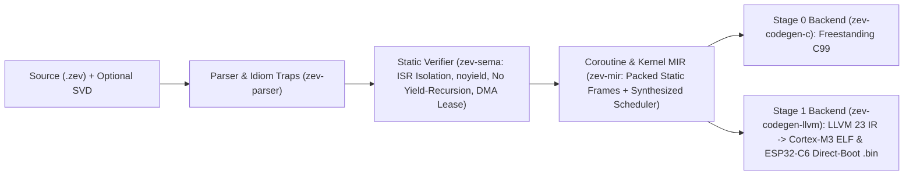

# Zev Language-OS — Design Notes (v0)

## 1. Core Thesis

In desktop and server software, the operating system lives outside the binary behind a syscall boundary. In bare-metal firmware, **Platform + OS + Libraries + Application** always compile into one flat static binary—yet C forces artificial walls between them (RTOS port layers, manual coroutine state structs, callback tables, `#ifdef` config headers, linker scripts) because C only understands functions and structs, not tasks, interrupts, deadlines, or hardware ownership.

**Elevator Pitch:**
> *Go's "batteries-included" concurrency composability—backed by a zero-heap, single-stack cooperative bare-metal scheduler instead of a garbage collector.*

Where [SyntropicOS](../SyntropicOS/README.md) pushes C99 to its limits via Duff's-device protothreads, manual state structs, and custom AST linters, **Zev** (`zevc` / `.zev`) makes the cooperative kernel, static coroutine packing, and ISR/task safety native to the compiler.

---

## 2. Core Semantic Pillars

### 2.1 Entry Point & Reusable Task Blueprints
- Execution starts sequentially in `fn main()`, preserving top-to-bottom C readability and phased boot (e.g., running hardware init and self-tests *before* control loops start).
- `task` definitions are **parameterized, reusable blueprints** (not auto-running global singletons). Libraries can export task definitions cleanly without hidden background execution, and `main()` can `spawn` multiple instances (e.g., one per UART bus).
- **100% Static Allocation:** Every `spawn` site maps to a compile-time-allocated task slot and coroutine state frame. Zero `malloc()`, zero per-thread stacks—all tasks execute on the single hardware stack.

### 2.2 Built-In Cooperative Scheduler & Power Management
- Priorities (`@critical`, `@high`, `@normal`, `@low`) with configurable starvation bounds (`Overdue -> Work -> Poll` dispatch).
- **Demand-driven chunking (`should_share`):** Long background loops execute back-to-back at full speed when uncontended, yielding `MORE` only when an equal/higher-priority task wakes or a peer hits its starvation bound.
- **Automatic Tickless Idle:** When all active tasks are blocked on primitives or timer deadlines, the synthesized runtime enters low-power sleep until the next hardware IRQ or deadline.

### 2.3 Yielding: Automatic by Default, Explicit Brakes When Needed
- **Default (Call-Graph Inferred):** Calling a yielding function inside a task yields transparently without `.await` coloring across every layer, and long loops can auto-insert cooperative `should_share()` checkpoints. Live local variables across yields are automatically packed into the task's static frame (union-aliasing disjoint child call frames).
- **Explicit Escape Hatches:**
  - `noyield { ... }` *(task-atomic)*: Compiler statically rejects any yielding call or checkpoint inside the scope. Protects multi-step state updates and keeps tight DSP/PID loops in CPU registers at `-O3` speed. Automatically enforced on all `isr` paths.
  - `critical { ... }` *(hardware-atomic)*: Implies `noyield` plus masks hardware interrupts (`PRIMASK` / `MIE`) for timed register sequences; compiler forbids unbounded loops inside.
  - `@manual_yield` + `checkpoint()`: Suppresses auto-yielding inside loops holding external hardware invariants (e.g., SPI `CS` asserted low) so yields only occur at clean transaction boundaries.

### 2.4 Task/ISR Isolation & Cohesive DMA Primitives
- Tasks own private state; arbitrary shared mutable globals across tasks/ISRs are disallowed (preserving both clarity and dual-core portability on chips like RP2040/ESP32).
- Cross-boundary interaction goes exclusively through **scheduler-aware static primitives**:
  - `signal` — lightweight event wakeup.
  - `chan<T, N>` / `inbox<T, N>` — bounded static queues for Active-Object sequential event loops.
  - `watch<T>` — single-writer, zero-lock latest-value publication.
  - `ping_pong<T, N>` / `lease<T, N>` — **zero-copy static buffer lending** across the `isr`/DMA ↔ `task` boundary.
- **Hardware Philosophy ("Runs on Anything" + Bare-Metal Control):**
  The core language stays hardware-agnostic (runs on Linux host sim, 8-bit AVR, RISC-V, Cortex-M). Chip-specific registers and write-1-to-clear operations are generated cleanly from **CMSIS-SVD** definitions without restrictive HAL wrappers, while `ping_pong` / `lease` make custom bare-metal DMA safe and zero-copy.
- **Dataflow + Scheduling Fusion:** Because primitives integrate with the scheduler, an `isr` can post with priority elevation (`sup_inbox.post(Overcurrent, boost: @critical)`), temporarily boosting the handler task until that turn completes, and task-to-task waits support automatic priority inheritance.
- **Strictly Sequential Control Flow (No `select`):** Multi-source tasks pull typed events from a single `inbox` followed by a standard `switch`, and timeouts use sequential deadlines (`recv(timeout: 5s) or IdleCheck`), keeping task wait state `O(1)`.

### 2.5 Everyday Types & Dual-Exit Error Model
- **Explicit Types Everywhere:** C-style `Type name = ...` declarations (`u8`, `u16`, `i32`, `[]u8` fat slices)—no `let`/`var` hiding bit-widths, overflow boundaries, or static task RAM costs.
- **Wire-Exact Layout:** `packed struct` with native endian types (`u16be`, `u32le`) for fieldbus/network protocols.
- **Distinct `return` vs. `error` Exit Paths:**
  - `return val;` always represents normal completion (`r1 == 0`, `r0 = val`).
  - `error [reason [, partial_val]];` represents failure (`r1 != 0`, optional partial progress `partial_val` in `r0` at zero extra register cost):
    - `error;` — simple boolean failure (no single-use enum boilerplate).
    - `error BadCrc;` — typed failure (error enums contain only real errors, no fake `OK`).
    - `error Timeout, bytes_read;` — typed failure *plus* partial progress in `r0`.
  - Callers handle failure symmetrically via `or <fallback>` or `catch ([ErrType err [, ValType partial]]) { ... }`.

### 2.6 Agent-First Diagnostics & Progressive Disclosure (`zevc doc`)
- **Foreign-Idiom Parser Traps (`P0001`..`P0010`):** Actively detects Rust/Zig/Go/C muscle-memory constructs (`let`/`var`, `fn f(x: T) -> R`, `async`/`.await`, `select`, `match`, `catch |e|`, `!T`/`try`, `for`, `'a`/`&mut`, `static`/`pub`) and emits 1-shot idiomatic Zev rewrites.
- **Actionable Verifier Diagnostics (`E0001`..`E0024`) & `--json`:** Includes shortest-path transitive yield call chains (`isr -> f1 -> f2 -> checkpoint()`), primitive method fuzzy suggestions (`inbox.send` -> `inbox.post`), `= docs: run 'zevc doc CODE'`, and machine-readable `zevc check --json`.
- **Self-Documenting Binary (`zevc doc`):** Ships a ~80-line quick primer + Rosetta Stone, 8 sharded topic guides (`syntax`, `errors`, `tasks`, `yielding`, `primitives`, `dma`, `runtime`, `targets`), and `BAD` vs `GOOD` `.zev` explainers for all 34 error codes directly inside `zevc`.

---

## 3. Compiler Pipeline (`zevc`)

- **Why a State-Machine MIR in the middle:** Coroutine lowering, disjoint frame union-packing, and scheduler synthesis happen *above* the backend. Stage 0 emits clean freestanding C99 for immediate host/ASan verification and legacy toolchains, while Stage 1 emits native LLVM 23 IR + vector tables / ROM Direct-Boot headers + linker scripts directly into freestanding bare-metal ARM Cortex-M3 and RISC-V ESP32-C6 firmware.

---

## 4. Reference Example

See [`examples/motor_controller.zev`](examples/motor_controller.zev) for the complete ~110-line North Star slice demonstrating dual-bus circular UART DMA, `main()` + multi-instance `spawn`, `every 1ms` control loop with `noyield`, ISR priority boost, and `return`/`error`/`catch`.

---

## 5. Edge-Case & Systems Rules

1. **Pointers & Slices Across Yields (Zero Lifetime Syntax):**
   Whole-program scope-depth and lease-origin inference tracks temporary pointers and slices automatically. Local wrapper structs (e.g., `ByteReader` holding a DMA slice) work naturally with zero `'a` annotations, while escaping a reference to an outer scope (`depth(dest) < depth(origin)`) or reading a leased DMA buffer past the next `wait_chunk()` is a compile error.
2. **Task Lifecycle & Operating Modes (No External Task Killing):**
   There is no external `kill`/`stop` API that could yank a task mid-hardware-transaction. Mutually exclusive workflows (e.g., Calibration vs. DFU) are ordinary yielding functions whose static local frames `union`-overlap automatically; persistent hardware tasks observe mode changes via `watch`/`inbox`, place their own peripherals into a safe state, and park at zero CPU cost; one-shot tasks simply `return`.
3. **Timebase & Automatic Sleep Locks:**
   Core-level critical sections and IRQ vector/controller ops are emitted natively by the compiler. For time, projects either initialize the standard core timer in `main()` after PLL setup (`sys.use_systick(170_000_000)`) or supply custom `now_ticks()` + `sleep_until(wake_tick, allowed_depth)` hooks (e.g., `LPTIM`/`RTC`/`SYSTIMER`). Active hardware primitives (`ping_pong`, `lease`) automatically clamp `allowed_depth` to keep peripheral clocks alive during active transfers.
4. **Hybrid Multicore Execution:**
   Because stackless coroutine frames leave nothing on the CPU stack at yield points, unpinned tasks can run dynamically across symmetric cores (e.g., RP2040, ESP32-S3) with zero stack copying (~15–25 cycles spinlock + barrier at yields), while `@core(N)` pins hard-real-time or core-local-IRQ tasks to dedicated silicon (and is required on asymmetric MCUs like Cortex-M7+M4). Single-core and fully-pinned builds compile out all multicore locks/barriers.
5. **C Interop (`extern "C"`):**
   External C functions are implicitly `noyield`. Any function callback passed *into* C (e.g., filesystem block-device hooks) is also statically enforced as `noyield` so a stackless yield can never unwind through active C stack frames on the shared hardware stack.
