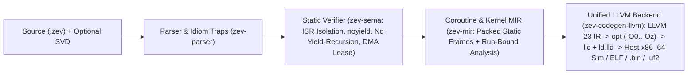

# Zev Language-OS — Design Notes (v0)

## 1. Core Thesis

In desktop and server software, the operating system lives outside the binary behind a syscall boundary. In bare-metal firmware, **Platform + OS + Libraries + Application** always compile into one flat static binary—yet C forces artificial walls between them (RTOS port layers, manual coroutine state structs, callback tables, `#ifdef` config headers, linker scripts) because C only understands functions and structs, not tasks, interrupts, deadlines, or hardware ownership.

**Elevator Pitch:**
> *Go's "batteries-included" concurrency composability—backed by a zero-heap, single-stack cooperative bare-metal scheduler instead of a garbage collector.*

Where traditional embedded C pushes C99 to its limits via Duff's-device protothreads, manual state structs, and external static linters, **Zev** (`zevc` / `.zev`) makes the cooperative kernel, static coroutine packing, and ISR/task safety native to the compiler.

---

## 2. Core Semantic Pillars

### 2.1 Entry Point, Boot-Tree `spawn` & Immortal Task Lifecycle
- **Phased Sequential Boot (`fn main()`):** Execution starts sequentially in `fn main()`, preserving top-to-bottom C readability and phased boot (e.g., running PLL/clock setup and self-tests *before* control loops start).
- **Reusable Task Blueprints:** `task` definitions are **parameterized, reusable blueprints** (not auto-running global singletons). Libraries can export or encapsulate internal worker tasks cleanly without hidden background execution, and boot setup can `spawn` multiple instances (e.g., one per UART or SPI bus).
- **Boot-Tree `spawn` (Static Topology Wiring, `<= 32` Slots):** `spawn` is permitted inside `fn main()` (including conditional `if` / `switch` boot-mode branches) **and** inside any setup `fn` called during `main()`'s sequential boot phase before the scheduler starts, while statically **forbidden** inside loops, recursion, `task`s, and `isr`s (`E0027`, which also enforces the static `MAX_TASKS <= 32` scheduler limit so ready/waiter masks stay `O(1)` 32-bit words). Every static boot-tree call path maps 1:1 to a compile-time-allocated `.bss` task slot and coroutine state frame (`0 B` heap, zero per-thread stacks—all tasks execute on the single hardware stack), and `zevc ram` prints the full static spawn provenance path (e.g., `main -> usb.start -> usb::xfer_task @high`) plus static non-yielding run bounds (`straight-line` / `bounded-for` / `noyield-spin`) so libraries never hide task counts, SRAM budgets, priorities, or long spin loops.
- **Immortal Task Lifecycle (`E0026`):** Tasks model permanent subsystem actors rather than dynamic threads:
  - Both `return;` and falling off the closing `}` of a `task` body are compile-time errors (`E0026`), preventing silent dead `.bss` slots and producer/consumer channel deadlocks.
  - **`restart;`:** Explicit self-reset statement inside a `task` that unwinds active `defer`s, restores any temporary priority boost, zeroes task-local state and nested child call frames (`MirStmt::ZeroTaskLocals`, preserving `spawn` parameters), and jumps cleanly back to task entry on fault recovery.
  - **Dormant / Triggered Tasks:** Background or CLI-triggered subsystems park on `inbox.recv()`, `signal.wait()`, `wait { ... }`, or `wait_queue` at `0%` CPU cost until needed.
  - **Finite / Mutually Exclusive Workflows:** Foreground sequences (e.g., power-on self-test, calibration, DFU) are ordinary yielding `fn` calls whose static coroutine frames automatically `union`-overlap in caller SRAM.
  - **Test / Sim Exit:** Deterministic host simulations and QEMU test harnesses terminate explicitly via `sys.exit(code)`.

### 2.2 Built-In Cooperative Scheduler, Loop Semantics & Power Management
- **O(1) Ranked Dispatch & Fixed Starvation Bounds:** Priorities (`@critical`, `@high`, `@normal`, `@low`) with fixed starvation windows (`1 / 5 / 15 / 50 ms`, `Overdue -> Work -> Poll` dispatch) backed by per-priority `u32` ready bitmasks (`@__syn_ready_mask`) across up to 32 static task slots.
- **Demand-Driven Chunking (`should_share`):** Long background loops execute back-to-back at full speed when uncontended, yielding `MORE` only when an equal/higher-priority task wakes or a peer hits its starvation bound.
- **Uniform Cooperative Loop Auto-Checkpointing:** `loop`, `while (true)`, and `while (cond)` all auto-checkpoint cooperatively at back-edges (`SoftYielding` / `HardBlocking`) outside `noyield`, `critical`, `isr`, `defer`, or `@manual_yield`, whereas bounded `for..in` loops (`for (usize i in 0..n)` / `for (u8 b in slice)`) stay in CPU registers without auto-yielding. Wrap intentional tight register-polling `while` loops explicitly in `noyield { while (...) {} }`.
- **Init vs. Steady-State Loop Structure:** Inside a `task`, statements before `loop { ... }` represent one-time per-instance initialization and persistent hoisted state; any statement placed after a `break`-less diverging `loop` (or after `return`, `error`, `restart`, or `sys.exit`) is rejected as a compile-time unreachable-code error (`E0025`).
- **Periodic Deadline Loops (`loop every <period>`):**
  - Spelling periodic loops `loop every <period> { ... }` (trapping bare `every` via `P0011`) makes them visually unmistakable as imperative loops, accepts both duration literals and runtime period expressions (e.g., configurable control rates), and **skips/resyncs missed deadlines on overrun** (`next_wake += k * period` past `now`) instead of bursting back-to-back catch-up iterations.
- **Idle Sleep & Deadline Safety:** Timebases run from a 1 kHz `SysTick`, a pure-`.zev` timer `isr` (`sys.tick()`), or an explicit hardware clock hook (`sys.set_clock_ms`). When all tasks are blocked, the runtime enters low-power sleep (`wfi` / `sleep` on Cortex-M and AVR; RISC-V emits masked `wfi` when IRQs are attached and zero timer deadlines depend on a polled clock, or a lightweight `nop` poll otherwise). On Cortex-M, `allow_sleep_deep` defaults `false` and `SCB->SCR` `SLEEPDEEP` is automatically suppressed whenever DMA sleep locks OR pending timer deadlines (`@__syn_has_deadline_waiter`) exist.

### 2.3 Yielding, Three-Tier Function Effects & Run Bounds
- **Call-Graph Inferred (Zero `async`/`.await` Coloring):** Calling a yielding function yields transparently on the shared stack, and live local variables across yields are packed into the caller's static frame via CFG backward-liveness analysis (union-aliasing disjoint child call frames).
- **Three-Tier Inferred Function Effects:**
  1. **Non-Yielding:** Contains no yields (`for..in`, straight-line logic, or `noyield { ... }`); compiles to a direct LLVM stack call (`0 B` `.bss`) and is legal everywhere, including inside `noyield`, `critical`, `isr`, `defer`, and `extern "C"` callbacks.
  2. **Soft-Yielding / Shareable:** Terminating compute/polling functions containing `checkpoint()` or unguarded `while (cond)` loops:
     - In normal cooperative `task` flow, compiles as a nested coroutine (`union`-packed child frame) so background compute shares the CPU smoothly.
     - Inside `noyield { ... }`, **auto-specializes a direct stack-only clone** (`{fn}__noyield`, `0 B` `.bss`, checkpoints stripped to no-ops) so the exact same library function runs at full register speed without code duplication.
     - Remains **statically forbidden** inside `critical { ... }`, `isr` handlers, `defer`, and `extern "C"` callbacks so long compute routines can never stretch hardware interrupt-masked latency.
  3. **Hard-Blocking:** Awaits external time or events (`delay`, `wait { ... }`, `inbox.recv`/`send`, `watch.wait_change`, `signal.wait`, `ping_pong.wait_chunk`, `byte_ring.wait_read`, `pool.alloc`, `wait_queue.commit_wait`, `loop every`, or non-terminating `loop`); legal only in cooperative `task` flow (and sequential `main()`).
- **Per-Task Non-Yielding Run Classification & Dual-Specialization Visibility:** `zevc ram` and `zevc check --json` report both `dual_specialized_functions` and per-task worst-case non-yielding run bounds (`max_run_kind`: `straight-line`, `bounded-for`, or `noyield-spin`, plus `max_run_blocks`) computed over intra-step MIR control-flow graphs and folded `Direct`/`Coroutine` callees.
- **Explicit Atomicity Escape Hatches:**
  - `noyield { ... }` *(task-atomic)*: Forbids hard-blocking yields and scheduler interleaving while keeping hardware IRQs enabled; keeps tight DSP/PID temporaries (`duty`) and intentional polling loops (`while ((USART3.status & 0x20) == 0) {}`) non-yielding.
  - `critical { ... }` *(hardware-atomic)*: Masks hardware interrupts (`PRIMASK` / `MIE` / `SREG`) and forbids both soft/hard yields and unbounded `loop`s.
  - `@manual_yield` + `checkpoint()`: Suppresses auto-yielding inside loops holding external hardware invariants (e.g., SPI `CS` asserted low) so yields only occur at clean transaction boundaries.

### 2.4 Task/ISR Isolation, Atomic Wait/Wake, `wait { ... }` & Driver Model
- **Strict Global Isolation:** Arbitrary shared mutable globals across tasks/ISRs are statically rejected (`E0001`/`E0002`), preserving ISR preemption safety and deterministic actor isolation.
- **Core Scheduler-Aware Static Primitives & `std.sync`:**
  - `signal` — lightweight event wakeup (`wait`, `try_wait`, `notify`).
  - `inbox<T, N>` *(unified bounded queue; retired `chan<T, N>` trapped via `P0012`)* — single bounded static queue supporting non-blocking `.post(v [, boost: @prio])` / `.try_send(v)` (ISR- and task-safe), yielding backpressured `.send(v [, timeout: d])` (task-only), blocking `.recv([timeout: d])`, and non-blocking `.try_recv()`.
  - `watch<T>` — single-writer, zero-lock latest-value cell (`publish`, `read`, `wait_change([timeout: d])`).
  - `wait_queue` + `std.sync` (`Semaphore`, `EventFlags`, `Latch`, `Barrier<N>`) — low-level 32-bit waiter-bitmask primitive (`.prepare_wait()`, `.cancel_wait()`, `.commit_wait([timeout: d])`, `.wake_one([boost:])`, `.wake_all([boost:])`) enabling arbitrary synchronization abstractions in plain `.zev` library code with zero lost wakeups.
  - `@dma_safe ping_pong<T, N>` — dedicated to contiguous `2 * N` hardware circular DMA (`HALF_TRANSFER` / `FULL_TRANSFER` double-buffering across the `isr`/DMA ↔ `task` boundary; standalone v0.1 `lease<T, N>` retires into `pool<T, K>` + `Lease<T>` below).
- **Dataflow + Scheduling Fusion:** An `isr` can post with priority elevation (`sup_inbox.post(Overcurrent, boost: @critical)`), temporarily boosting the handler task until that turn completes before restoring its base priority.
- **Race-Free Atomic Poll+Park & Deterministic Multi-Source `wait { ... }` (`P0004`):**
  - Every primitive maintains a `u32` waiter bitmask (1 bit per task slot) and every single- or multi-arm block lowers to unified `MirYieldKind::Wait`.
  - Under a single interrupt-masked critical section, arms are polled top-to-bottom deterministically; if none is ready, the task registers its slot bit in each arm's waiter mask (and earliest deadline in `@__syn_has_deadline_waiter`), parks cleanly, and exits the critical section—closing ISR lost-wakeup races completely.
  - `wait { ... }` restricts arms to direct primitive operations (`recv`, `send`, `wait`, `wait_change`, `wait_read`, `wait_chunk`, `alloc`, `commit_wait`) plus optional relative idle `timeout d =>` or absolute periodic `deadline tick =>` (`P0004` traps `select` with an immediate rewrite to `wait { ... }`), guaranteeing at most one arm executes, zero half-run coroutine cancellation hazards, and per-arm slice lease scoping (`E0011`/`E0034`).
- **Whole-Program Visibility Optimizations:** Because `zevc` analyzes the complete static task/ISR call and primitive graph before codegen, it applies four zero-annotation whole-program optimizations:
  1. **Automatic IRQ-mask elision:** Task-to-task queues and 1-ISR SPSC queues elide `PRIMASK`/`MIE` interrupt masking automatically, emitting IRQ critical sections only when preempting writers/ISRs actually contend.
  2. **Singleton subsystem constant-folding (`instance_count == 1`):** Single-instance driver `struct`s and `task`s constant-fold their instance and MMIO pointers directly into immediates (`0` pointer-indirection cost).
  3. **Dead `watch` stripping (`readers == 0`):** Unread telemetry/debug `watch<T>` cells strip to `0 B` `.bss` and no-op `publish` sites automatically.
  4. **Static single-stack + `.bss` high-water proof:** Combines the non-recursive call graph (`main`, task step functions, and nested ISR preemption levels) with LLVM `.stack_sizes` metadata to prove worst-case total SRAM usage in `zevc ram`.
- **Top-Half / Bottom-Half High-Throughput Driver Model (USB / Wi-Fi / Radio):**
  - Hardware `isr`s act strictly as `< 2 µs` top-halves (acknowledge hardware flags, swap/enqueue descriptor, wake `@critical` driver task with `boost: @critical`), while protocol state machines run in a bottom-half `@critical` `task` with hardware interrupts enabled (interfacing with vendor binary blobs via `noyield`-verified `extern "C"` callbacks).
  - **Hardware & High-Throughput Driver Primitives:**
    1. **Typed `mmio` Register Blocks (`@rw`, `@ro`, `@wo`, `@w1c` + Widths & Arrays):**
       ```zev
       mmio UsbRegs @ 0x6000_F000 {
           @rw  u32 ep1_fifo  @ 0x00;
           @ro  u32 int_st    @ 0x0C;
           @w1c u32 int_clr   @ 0x14;   // Forbids `|=` / `&=` read-modify-write!
           @rw  u16 ep_cfg[8] @ 0x20;   // Sub-word widths (`u8`/`u16`/`u32`) & channel arrays
       }
       ```
       - Statically forbids writes to `@ro` registers and statically forbids read-modify-write (`|=`, `&=`) on `@w1c` / `@wo` interrupt-clear registers (`USB0.int_clr = flags;` only), preventing classic W1C interrupt-loss bugs; auto-generated from CMSIS-SVD via `zevc import-svd <chip.svd>`.
    2. **ISR-Private `state` Variables:**
       ```zev
       isr USB_IRQ {
           state u8 pending_addr = 0;   // Static `.bss` scoped exclusively to `USB_IRQ`
           ...
       }
       ```
       - Mutable static `.bss` storage scoped and visible exclusively to a single `isr` across hardware interrupts (e.g., USB `EP0` `pending_addr` state), preserving zero cross-task sharing.
    3. **Lock-Free SPSC `byte_ring<N>` (Wrap-Around & Grant Invariant):**
       ```zev
       byte_ring<512> cdc_rx;
       // ISR: `[]u8 dst = cdc_rx.grant_write(len) catch { ... };` or `cdc_rx.push(chunk);`
       // Task: `[]u8 view = cdc_rx.read_slice(); ... cdc_rx.consume(view.len);`
       ```
       - Single-producer/single-consumer atomic head/tail ring requiring zero IRQ masking, providing both wrap-safe `push(slice)` / `pop(slice)` AND fallible contiguous `grant_write(len) error` (BipBuffer-style wrap-ahead when space permits, returning `error` on backpressure rather than silently truncating at buffer wrap-around).
       - `zev-sema` automatically invalidates any `read_slice()` view upon `consume(n)` so dangling ring slices are rejected at compile time.
    4. **Bidirectional Zero-Copy `@dma_safe pool<T, K>` + Move-Only `Lease<T>` (Superseding Standalone `lease<T, N>`):**
       ```zev
       @dma_safe pool<EthFrame, 8> net_pool;
       dma_slot<EthFrame>          eth_tx_inflight;
       inbox<Lease<EthFrame>, 8>   rx_inbox;
       ```
       - **In-flight DMA ownership across interrupts:** Because hardware DMA spans from register kickoff until a subsequent completion IRQ, a move-only `Lease<T>` cannot auto-free at the end of a kickoff scope—an explicit static in-flight parking slot (`dma_slot<T>` or ISR-private `state`) holds `Lease<T>` ownership until the completion `isr` releases or recycles it.
       - **Leak-free full-queue backpressure:** When `rx_inbox.post(lease)` fails because the destination queue is full under a packet burst/flood, `.post()` either auto-recycles `lease` back to `net_pool` or rejects via `error` so scope-exit returns the slot cleanly—making permanent pool exhaustion impossible.
       - **IRQ-safe `O(1)` bitmap allocator & cache-line alignment:** Because both `task` and `isr` allocate/free concurrently across preemptible boundaries, `pool<T, K>` uses an atomic/IRQ-masked `u32` bitmap free-list (`O(1)` bounded latency, zero linked-list races), and `@dma_safe` enforces DMA/cache-line alignment on pool slots so adjacent buffers never false-share cache lines with active DMA.

### 2.5 Everyday Types, Bounded Generics, Dual-Exit Errors & Defined Runtime Traps
- **Canonical Prefix Types Everywhere:** C-style `Type name = ...` declarations (`u8`, `u16`, `i32`, `f32`, `f64`, `*T` pointers, `[]T` fat slices, `[N]T` fixed arrays, `fn(A) -> R` callbacks; postfix `*` and `[]` trapped via `P0014`)—no `let`/`var` hiding bit-widths, overflow boundaries, or static task RAM costs.
- **Defined Runtime Safety Traps (`@__syn_panic`):** Out-of-bounds array/slice indexing (`a[i]`), out-of-bounds subslices (`a[s..e]`), out-of-bounds MMIO array indexing (`regs.arr[i]`), and integer division/remainder by zero (`x / 0`, `x % 0`) trap deterministically through `@__syn_panic` (emitting `[PANIC] ...`, invoking `sys.set_fault_handler()`, and exiting with non-zero code `101`), while signed `INT_MIN / -1` evaluates safely to `INT_MIN` and `INT_MIN % -1` evaluates to `0`.
- **Wire-Exact Layout:** `packed struct` with native endian types (`u16be`, `u32le`) decoded safely via `Type.from_bytes(slice)`.
- **Monomorphized `<T>` / `<T, usize N>` Generics (No Ad-Hoc Overloading, No Trait Hierarchies):**
  - User `.zev` `struct`s (`FixedVec<T, usize N>`) and `fn`s (`clamp<T>(...)`) may declare `<T>` and `<T, usize N>` parameters monomorphized before MIR lowering (`E0029` on invalid instantiations), with concrete Flash instantiations reported in `zevc ram` and `zevc check --json`.
  - C++-style ad-hoc function overloading (which risks silent register-width promotion bugs) and user-defined trait hierarchies / `'a` lifetime annotations are intentionally omitted.
- **Distinct `return` vs. `error` Exit Paths:**
  - `return val;` always represents normal completion (`r1 == 0`, `r0 = val`).
  - `error [reason [, partial_val]];` represents failure (`r1 != 0`, optional partial progress `partial_val` in `r0` at zero extra register cost):
    - `error;` — simple boolean failure (no single-use enum boilerplate).
    - `error BadCrc;` — typed failure (error enums contain only real errors, no fake `OK`).
    - `error Timeout, bytes_read;` — typed failure *plus* partial progress in `r0`.
  - Callers handle failure symmetrically via `or <fallback>` or single-/multi-statement `catch ([ErrType err [, ValType partial]]) { ... }`.
- **Zero-Heap Streamable `f"..."` Formatting (Per-Call-Site Dispatch, Zero Global Handler Registry):**
  - **Compile-Time Unpacked Sink Writes & Static Fit Proof:** `f"..."` unpacks at compile time into direct chunk writes across `print`, `println`, `fmt_buf(dst, f"...") -> []u8 error FmtErr`, and `fmt_ring(tx, f"..." [, boost: @prio]) -> usize error FmtErr`, proving worst-case buffer fit at compile time (`E0028`) when all arguments have statically bounded widths and returning dual-exit `error Truncated, clamped_slice;` (for `fmt_buf`) or `error Truncated, written_bytes;` (for `fmt_ring`) when inputs exceed available capacity.
  - **Call-Site Tiered Float Formatting (No Global `_printf_float` Swapping):** Because `zevc` resolves each `{...}` specifier at compile time rather than routing through a monolithic runtime `printf` table, `{temp}` / `{temp:.2}` emits a direct call to a compact (~150 B Arduino-style / scaled-integer) fixed-decimal converter while `{val:e}` calls a scientific float converter—so `ld.lld --gc-sections` links scientific float code *only* if `:e` appears in the program, and independent libraries never conflict over global float-handler state.
  - **`enum` Names & `{pkt:?}` Debug Without Custom Format Traits:** App-wide `Display`/`Format` traits and struct formatter registries are omitted (avoiding console-vs-log format conflicts; callers write `f"{pt.x},{pt.y}"` explicitly), while `zevc` provides automatic `enum` variant-name strings (`f"{err}"` -> `"BadCrc"`, `.rodata` emitted only for formatted enums) and optional `{pkt:?}` compile-time struct field debug expansion.
- **Zero-Cost Control-Flow Conveniences:**
  - **`defer <stmt>;` / `defer { ... }`:** Executes deterministic LIFO scope-exit hardware/resource cleanup across `return`, `error`, `break`, `continue`, `restart`, and `sys.exit`.
  - **Bounded `for..in` Loops:** Supports `for (u8 b in slice)` and `for (usize i in 0..n)` / `0..=max` while keeping C's 3-clause `for (;;)` and untyped `for` forbidden (`P0008`).

### 2.6 Agent-First Diagnostics & Progressive Disclosure (`zevc doc`)
- **Foreign-Idiom Parser Traps (`P0001`..`P0014`):** Actively detects Rust/Zig/Go/C muscle-memory and retired syntax (`let`/`var`, `fn f(x: T) -> R`, `async`/`.await`, `select`, `match`, `catch |e|`, `!T`/`try`, C-style `for (;;)`, `'a`/`&mut`, `static`/`pub`, bare `every`, `chan<T, N>`, standalone `lease<T, N>`, and postfix `*`/`[]`) and emits 1-shot idiomatic Zev rewrites.
- **Actionable Verifier Diagnostics (`E0001`..`E0034`) & `--json`:** Includes shortest-path transitive yield call chains (`isr -> f1 -> f2 -> checkpoint()`), static `fmt_buf`/`fmt_ring` capacity proofs (`E0028`), generic instantiation checks (`E0029`), module/MMIO/IRQ/state checks (`E0030`–`E0033`), linear `Lease<T>` ownership checks (`E0034`), primitive method fuzzy suggestions (`watch.write` -> `watch.publish`), `= docs: run 'zevc doc CODE'`, and machine-readable `zevc check --json` (including `task_runs`, `dual_specialized_functions`, and `monomorphized_instances`).
- **Self-Documenting Binary (`zevc doc`):** Ships a ~80-line quick primer + Rosetta Stone, 8 sharded topic guides (`syntax`, `errors`, `tasks`, `yielding`, `primitives`, `dma`, `runtime`, `targets`), and `BAD` vs `GOOD` `.zev` explainers for all 48 error codes directly inside `zevc`.

### 2.7 Modules, Libraries & Core-vs-Library Boundary
- **Modules & Visibility (`import` + `pub`):** File and directory modules default to module-private declarations with explicit `pub` exports (`pub struct`, `pub fn`, `pub task`, `pub const`, `pub enum`, `pub mmio`, `pub irq`), replacing v0.1's single-file `P0010` placeholder trap on `pub` so subsystems encapsulate internal state and worker tasks cleanly.
- **Compile-Time `irq` Token Delegation (`attach` / `attach_shared`):**
  - Hardware `irq` vectors are compile-time SVD tokens bound inside boot-tree setup (`vec.attach(uart_isr(port, regs))`) with **zero RAM vector tables and zero runtime function pointers**—synthesizing Flash `.isr_vector` (ARM Cortex-M NVIC) and RISC-V `INTMTX` + `mtvec` (ESP32-C6) handlers with constant instance and MMIO pointers baked directly into codegen.
  - Exclusive `attach` catches accidental duplicate IRQ bindings across libraries at compile time, while shared hardware lines (`EXTI9_5`, `GPIO`) opt in explicitly via `attach_shared` to synthesize a static sequential poll chain inside one Flash ISR.
- **Subsystem `struct`s & Unsized Primitive Views (Zero Vtables, Zero Per-Capacity Flash Bloat):**
  ```zev
  pub struct UartDriver {
      byte_ring<256> rx;
      byte_ring<256> tx;
  }
  // `&drv.rx` (`*byte_ring<256>`) coerces to capacity-erased `*byte_ring`
  ```
  - Static `struct`s may embed OS primitives (`inbox`, `watch`, `byte_ring`, `signal`, `pool`), and sized primitive pointers coerce to capacity-erased views (`*byte_ring`, `*inbox<T>`, `*watch<T>`, analogous to `[N]u8` -> `[]u8`).
  - Enables reusable multi-instance drivers (`UartDriver bus1; UartDriver bus2;`) and protocol stacks over differently sized queues with **zero dynamic vtables and zero `<usize N>` protocol code duplication**, verified via static-path alias and SPSC checking in `zev-sema`.
- **Strict Core-vs-Library Boundary (Occam's Razor for Primitives):**
  - **Inside `zevc` (Core Language ONLY):** Strictly constructs that directly touch scheduler wait/wake state, coroutine frame lowering, static ISR/DMA memory provenance, volatile MMIO/IRQ codegen, or compile-time `f"..."` unpacking: `task`, `spawn`, `irq`, `mmio`, `packed struct`, `signal`, `watch`, unified `inbox`, `byte_ring`, `ping_pong` (contiguous circular DMA), and `pool`+`Lease` (retiring standalone v0.1 `lease`).
  - **Outside `zevc` (Plain `.zev` Libraries):**
    - `chip/*.zev` — SVD-generated `mmio` + `irq` maps (replacing hardcoded compiler `chip.*` intrinsics).
    - `bsp/*.zev` — board pinmux, clock tree, and DMA channel wiring.
    - `std/*` (`std/io.zev`, `std/bus.zev`, `std/fmt.zev`) — ordinary `.zev` structs and formatting helpers composed from `*byte_ring` / `*inbox` views (e.g., duplex byte streams, half-duplex RS-485 links, or shared I2C/SPI bus handles—**not** built-in compiler primitives).
    - Protocol & compute libraries (`modbus`, `cli`, `fft`, `x25519`) — pure `.zev` with zero `mmio`/`irq` imports, unit-testable deterministically on the host via in-memory primitives.
- **Explicit Compile-Time Unrolling Trade-Offs:**
  - **Whole-program Zev source compilation:** All `.zev` modules compile together for global isolation proofs, coroutine frame union-packing, and static Flash vector synthesis; closed vendor binary blobs link via `noyield`-verified `extern "C"`.
  - **Static-path subsystem arguments:** Subsystem wiring requires compile-time-resolvable static instance paths (`&bus1`, `&ports[0]`) and rejects runtime-indexed `&ports[runtime_i]` so SPSC, aliasing, and IRQ provenance remain statically decidable.
  - **Conditional boot-branch `irq` binding:** Synthesizes a minimal runtime dispatch flag *only* when mutually exclusive `if`/`else` boot branches bind the same physical `irq`; single-target `attach` emits zero-branch direct Flash dispatch.

---

## 3. Compiler Pipeline (`zevc`)



- **Why One Unified State-Machine MIR + LLVM Backend:** Coroutine lowering, backward-liveness variable hoisting, disjoint frame union-packing, and scheduler synthesis happen *above* LLVM codegen (`MirModule`), and **`zev-codegen-llvm`** compiles the exact same `MirModule` scheduler state machine and IR runtime for both:
  - **Sanitized Host Simulation (`x86_64` Linux):** Emits host LLVM IR linked via `/bin/clang -fsanitize=address,undefined` (`zevc run --sanitize`), plus `sys.fuzz_irqs(seed, mask)` for deterministic critical-section IRQ interleaving tests under ASan/UBSan.
  - **Bare-Metal MCU Targets:** Passes opaque-pointer LLVM 23 IR through middle-end `/bin/opt` + `/bin/llc` (`-O0`, `-O1`, `-O2` default, `-O3`, `-Os` `optsize`, and `-Oz` `minsize`—preserving freestanding zero-libc startup) and links via `/bin/ld.lld` into ARM Cortex-M3/M4F/M0+ `.elf`/`.bin`/`.uf2`, Espressif ESP32-C6 (`rv32imac`) Direct-Boot `.bin`, Microchip ATmega328P (`avr`), and Microchip ATmega4809 (`avrxmega3`) images.

---

## 4. Reference Examples

- [`examples/motor_controller.zev`](examples/motor_controller.zev) + [`examples/motor_support.zev`](examples/motor_support.zev) — North Star dual-bus STM32G4 motor controller demonstrating `main()` + multi-instance `spawn`, periodic `noyield` PI loop, circular `ping_pong` UART DMA, `u16be` wire frames, ISR `boost: @critical`, and `24 B` disjoint child `union` SRAM savings.
- [`examples/sim_demo.zev`](examples/sim_demo.zev) — Deterministic ASan/UBSan host simulation timeline exercising big-endian DMA packets, `BadCrc` recovery, `EXTI0` priority boost/restore, and `LIGHT -> DEEP` sleep-lock clamping.
- [`examples/cortex_m_demo.zev`](examples/cortex_m_demo.zev) — Zero-C bare-metal ARM Cortex-M3 firmware executing live in `qemu-system-arm` with real NVIC preemption and `SysTick`.
- [`examples/esp32c6_demo.zev`](examples/esp32c6_demo.zev) — Zero-bootloader ESP32-C6-Pico (`rv32imac` Direct-Boot) firmware verified on physical silicon (`16 MHz SYSTIMER` `sys_now_ms`, pure-`.zev` hardware `RMT` WS2812B RGB driver on `GPIO8`, `GPIO9` button `boost: @critical`, singleton-folded `SerialPort` subsystem + `*byte_ring` `fmt_ring` serial commands, `std.bus.StatusCell`, `@dma_safe pool` + `Lease` + `dma_slot` hardware `GDMA` CH0 descriptor M2M transfers, `REGI2C` + eFuse-calibrated die-temperature sensor, and zero-C `USB_DEVICE` `console_putc` telemetry).
- [`examples/arduino_uno_demo.zev`](examples/arduino_uno_demo.zev) — Zero-C Microchip ATmega328P / Arduino Uno R3 (`avr` Optiboot STK500v1) firmware verified on physical silicon (`Timer0` 1 kHz `sys.tick()`, `Timer1` compare ISR, shared `PCINT0` ISRs, singleton-folded `SerialPort` `USART0` `console_putc` + RX + `IRQ_USART_UDRE` TX + `fmt_ring`, `@dma_safe pool` + `Lease` + `dma_slot` interrupt-driven `IRQ_SPI_STC` bursts, and 10-bit `ADC` `AVcc`/bandgap + `A0` telemetry).
- [`examples/arduino_nano_every_demo.zev`](examples/arduino_nano_every_demo.zev) — Zero-C Microchip ATmega4809 / Arduino Nano Every (`avrxmega3` `MuxTO` UPDI) firmware with 100% pure-`.zev` board bring-up (`bsp.init_board()` `CPU.ccp` WDT/clock unlock, `FUSE.OSCCFG` 16/20 MHz auto-detect, `SLPCTRL`, `isr systick_isr` `TCB3` 1 kHz `sys.tick()`, `pub fn console_putc(u8)` `USART3` sink, `TCB0` periodic ISR, shared `PORTE` `PE2` ISRs, `USART3` `byte_ring` + `fmt_ring`, `SIGROW`-calibrated die-temperature + `A0` telemetry, and `@dma_safe pool` + `Lease` + `dma_slot` `SPI0` `ALT2` bursts).
- [`examples/pico_w_demo.zev`](examples/pico_w_demo.zev) — Zero-C Raspberry Pi Pico W (`rp2040` `thumbv6m-none-eabi` Cortex-M0+ SRAM UF2, 264 KB unified `NO_FLASH` SRAM `0x2000_0000`) firmware verified on physical silicon: 125 MHz `PLL_SYS` / 48 MHz `PLL_USB` clocks and Full-Speed USB 1.1 CDC-ACM (`IRQ_USBCTRL` + `1200`-baud BootROM `RPI-RP2` auto-reset via `sys.exit(0x4255)` + `console_putc`) written **100% in `.zev`**, driving `ALARM0` (`IRQ_TIMER_0`), `PIO0` SM0 4-instruction inverter + dual-channel `DMA` CH0/CH1 (`IRQ_DMA_0`) with `@dma_safe pool` + `Lease` + `dma_slot`, `std.bus.StatusCell`, and on-die ADC ch4 temperature telemetry.

---

## 5. Edge-Case & Systems Rules

1. **Pointers & Slices Across Yields (Zero Lifetime Syntax):**
   Whole-program scope-depth and lease-origin inference tracks temporary pointers and slices automatically. Local wrapper structs (e.g., `ByteReader` holding a DMA slice) work naturally with zero `'a` annotations, while escaping a reference to an outer scope (`depth(dest) < depth(origin)`) or reading a leased DMA buffer past the next `wait_chunk()` is a compile error.
2. **Task Lifecycle & Operating Modes (No External Task Killing):**
   There is no external `kill`/`stop` API that could yank a task mid-hardware-transaction. Tasks are permanent subsystem actors (`restart;` resets a task cleanly to entry; dormant tasks park on `inbox`/`signal` at zero CPU cost), while mutually exclusive finite workflows (e.g., Calibration vs. DFU) are ordinary yielding `fn`s whose static local frames `union`-overlap automatically.
3. **Timebase, Console Hooks & Automatic Sleep Locks:**
   Core-level CPU critical sections, ISA vector tables, and interrupt-controller routing live in the compiler; **zero SoC/board peripheral MMIO drivers live in Rust/LLVM**. Instead, chip/board `.zev` libraries provide `pub mmio` / `pub irq` drivers plus optional `console_putc(u8)` / `sys.set_putc(fn(u8))` and `sys_now_ms() -> u32` / `sys.tick()` hooks (alongside `sys.use_systick(hz)` on Cortex-M cores). Active hardware primitives (`ping_pong`, `@dma_safe pool`/`Lease`) automatically clamp `allowed_depth` to keep peripheral clocks alive during active transfers.
4. **Single-Core v0 Scheduler (`@core(N)` Reserved):**
   In v0, the cooperative scheduler runs all spawned tasks on a single core without multi-core spinlocks; `@core(N)` is parsed and preserved as spawn metadata in MIR/`zevc ram` for future multi-core execution rather than dispatching across multiple cores today.
5. **C Interop (`extern "C"`):**
   External C functions are implicitly `noyield`. Any function callback passed *into* C (e.g., filesystem block-device or radio-stack hooks) is also statically enforced as `noyield` so a stackless yield can never unwind through active C stack frames on the shared hardware stack.

---

## 6. Implementation Status & Queued Compiler Work

### 6.1 Live in `zevc` v0.1 Today
- [x] Lexer, recursive-descent `.zev` parser, canonical prefix types (`P0014`), `f32`/`f64` float literals, `<T, usize N>` generics, `f"..."` interpolation, `wait { ... }` (`P0004`), `wait_queue`, and foreign-idiom traps `P0001`–`P0014` (`crates/zev-parser`).
- [x] Whole-program static verifier `E0001`–`E0034`: `<T, usize N>` monomorphization, 3-tier call-graph yield inference (including `while (cond)` auto-checkpointing), shortest-path yield traces, Boot-Tree `spawn` provenance (`MAX_TASKS <= 32`), immortal `task` + unreachable-code safety, static `fmt_buf`/`fmt_ring` capacity proofs, global/ISR isolation, `noyield`/`critical`/`defer`/`extern "C"` callback safety, zero-`'a` scope-depth, per-arm `wait` lease scoping, `wait_queue` + `std.sync` checks, DMA `ping_pong`, `byte_ring`, and linear `pool`/`Lease`/`dma_slot` ownership tracking, and fuzzy primitive/identifier hints (`crates/zev-sema`).
- [x] Built-in `zevc doc` progressive-disclosure primer, 8 topic guides, 48 verified `BAD`/`GOOD` error explainers, and `zevc check --json` with `task_runs`, `dual_specialized_functions`, and `monomorphized_instances` (`crates/zev-cli`).
- [x] CFG state-machine MIR lowering, backward-liveness frame variable hoisting, disjoint child coroutine `union` packing, `SoftYielding` `noyield` clone specialization, compile-time `f"..."` / `{pkt:?}` expansion, `MirStmt::ZeroTaskLocals` on `restart;`, per-task non-yielding run classification (`straight-line` / `bounded-for` / `noyield-spin`), and static zero-heap `zevc ram` budget & provenance reports (`crates/zev-mir`).
- [x] Unified LLVM 23 backend (`crates/zev-codegen-llvm`) compiling `O(1)` ready/waiter bitmask scheduling, race-free atomic poll+park, defined `@__syn_panic` runtime traps + safe `INT_MIN / -1`, RISC-V `wfi` & Cortex-M `SLEEPDEEP` deadline safety, deterministic `x86_64` Clang ASan/UBSan host simulation (`zevc run --sanitize` + `sys.fuzz_irqs`), bare-metal ARM Cortex-M3 `.elf` (`qemu-system-arm`), STM32F334R8 FPU `.bin`, ESP32-C6 (`rv32imac`) Direct-Boot `.bin`, ATmega328P (`avr`) & ATmega4809 (`avrxmega3`), and RP2040 (`thumbv6m-none-eabi` SRAM `.uf2`).

### 6.2 Established Semantic Refinements (Wave 1 & Wave 2 Complete)
- [x] Enforce **Boot-Tree `spawn`** (`E0027`): permit `spawn` inside `fn main()` (including conditional `if` / `switch` boot branches) and boot-only setup `fn`s called before scheduler start; forbid `spawn` inside loops, recursion, `task`s, and `isr`s; print full static spawn provenance paths (`main -> usb.start -> usb::xfer_task @high`) in `zevc ram`.
- [x] Compile-time unreachable-code error (`E0025`) on any statement following a `break`-less diverging `loop`, `return`, `error`, `restart`, or `sys.exit`.
- [x] Immortal `task` enforcement (`E0026`: reject `return;` and falling off `}` in `task` bodies) + `restart;` self-reset statement + `sys.exit(code)` termination rules.
- [x] Replace bare `every <lit> { ... }` (`P0011`) with `loop every <period_expr> { ... }` supporting runtime period expressions and overrun deadline skip/resync.
- [x] Three-tier function effect inference (*Non-yielding* / *Soft-yielding* / *Hard-blocking*) with automatic `noyield` stack-clone specialization of `checkpoint()`-only functions and explicit dual-specialization reporting in `zevc ram` / `zevc check --json`.
- [x] Unify `inbox<T, N>` and `chan<T, N>` (`P0012`) into a single bounded `inbox<T, N>` supporting non-blocking `.post(v [, boost: @prio])` / `.try_send(v)` (ISR/task-safe), yielding backpressured `.send(v [, timeout: d])` (task-only), `.recv([timeout: d])`, and `.try_recv()`.
- [x] Zero-cost `defer <stmt>;` / `defer { ... }` LIFO cleanup across `return`, `error`, `restart`, and `sys.exit`, plus bounded `for (u8 b in slice)` and `for (usize i in 0..n)` / `0..=max` loops (keeping C's 3-clause `for (;;)` forbidden via `P0008`).
- [x] Monomorphized `<T>` / `<T, usize N>` generics (`E0029`) on user `struct`s and `fn`s with concrete Flash instantiation reporting in `zevc ram` and `zevc check --json` (omitting C++-style overloading and user trait hierarchies).
- [x] Zero-heap per-call-site `f"..."` formatting across `print`, `println`, `fmt_buf`, and `fmt_ring` (`*byte_ring` / `*byte_ring<N>` stream sink with optional `boost:`): compile-time buffer-fit proof `E0028` + `error Truncated, ...;`, call-site tiered fixed-decimal vs. `:e` scientific float converters for `--gc-sections`, on-demand `enum` variant names, and `{pkt:?}` struct debug expansion.

### 6.3 Next-Stage Modules, Driver Architecture, Primitives & Optimizations
- [x] File/directory module system (`import` + private-by-default declarations + explicit `pub` exports, graduating `pub` out of `P0010`) and strict Core-vs-Library separation (`chip/*.zev` SVD maps replacing hardcoded `chip.*` intrinsics, `bsp/*.zev` board wiring, and plain-`.zev` `std/io`, `std/bus`, `std/fmt`).
- [x] Subsystem `struct`s embedding OS primitives + capacity-erased unsized primitive views (`*byte_ring`, `*inbox<T>`, `*watch<T>` view bundles) with static-path alias/SPSC checking in `zev-sema` (zero dynamic vtables, zero `<usize N>` protocol code duplication).
- [x] Compile-time `irq` token delegation (`vec.attach(handler(inst, regs))` and `attach_shared`) synthesizing zero-RAM Flash `.isr_vector` (ARM Cortex-M NVIC) and RISC-V `INTMTX` + `mtvec` (ESP32-C6) dispatch with baked constant instance pointers and compile-time duplicate-attachment checks.
- [x] Typed `mmio` register blocks (`@rw`, `@ro`, `@wo`, `@w1c` forbidding RMW on W1C/WO, `u8`/`u16`/`u32` widths, register arrays) + `zevc import-svd <chip.svd>`.
- [x] ISR-private persistent `state` variables (static `.bss` scoped exclusively to a single `isr`).
- [x] Lock-free SPSC `byte_ring<N>` with wrap-safe `push`/`pop`, BipBuffer-style `grant_write(len) error`, `wait_read([timeout: d])` with `boost:`, and compile-time `read_slice()` / `grant_write()` lease invalidation (`E0011`) on `consume(n)` / `commit_write(n)`.
- [x] Bidirectional zero-copy `@dma_safe pool<T, K>` + move-only `Lease<T>` handles (`E0034`, `defer` support) with `dma_slot<T>` in-flight parking across IRQs, leak-free full-queue `inbox.post(lease)` recycling, and IRQ-safe `O(1)` bitmap allocation + 32-byte cache-line alignment (retiring standalone v0.1 `lease<T, N>` via `P0013`, while keeping `@dma_safe ping_pong<T, N>` for contiguous `2 * N` hardware circular `HALF_TRANSFER` / `FULL_TRANSFER` DMA).
- [x] Whole-program visibility optimizations (`dead_stripped` unread `watch` stripping to `0 B` `.bss`, automatic IRQ-mask elision on task-only and uncontended primitive/view families) and static call-graph + LLVM `.stack_sizes` / AVR disassembly single-stack + `.bss` high-water proof in `zevc ram --target <cortex-m3|esp32c6|avr|nano-every|rp2040>`.
- [x] Singleton subsystem constant-folding (`instance_count == 1`) plus unique task param and single-assignment static ref/view propagation in `crates/zev-mir/src/opt.rs`.
